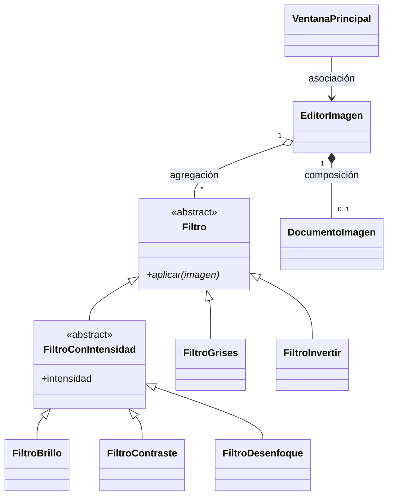
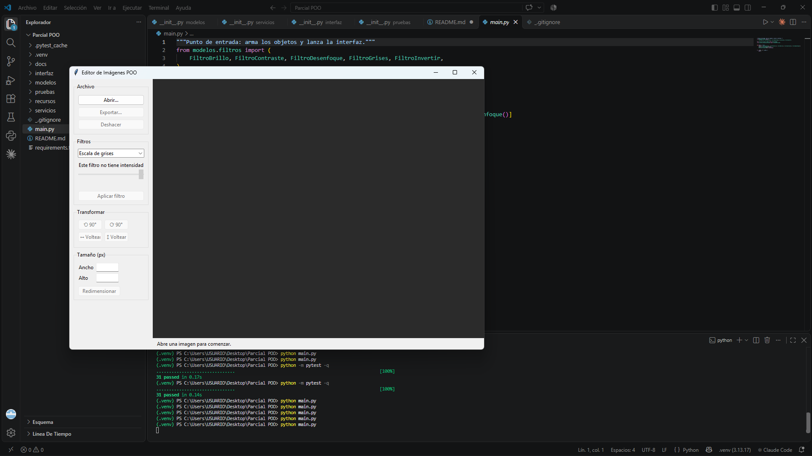
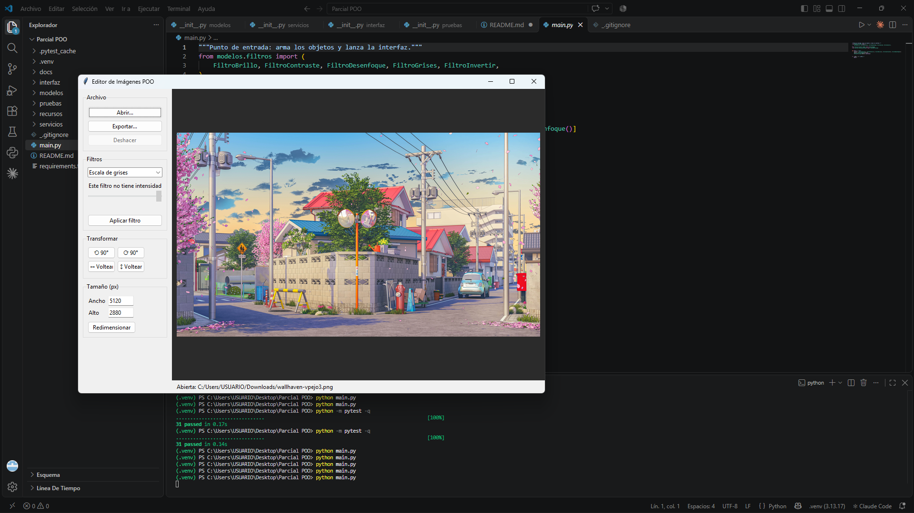
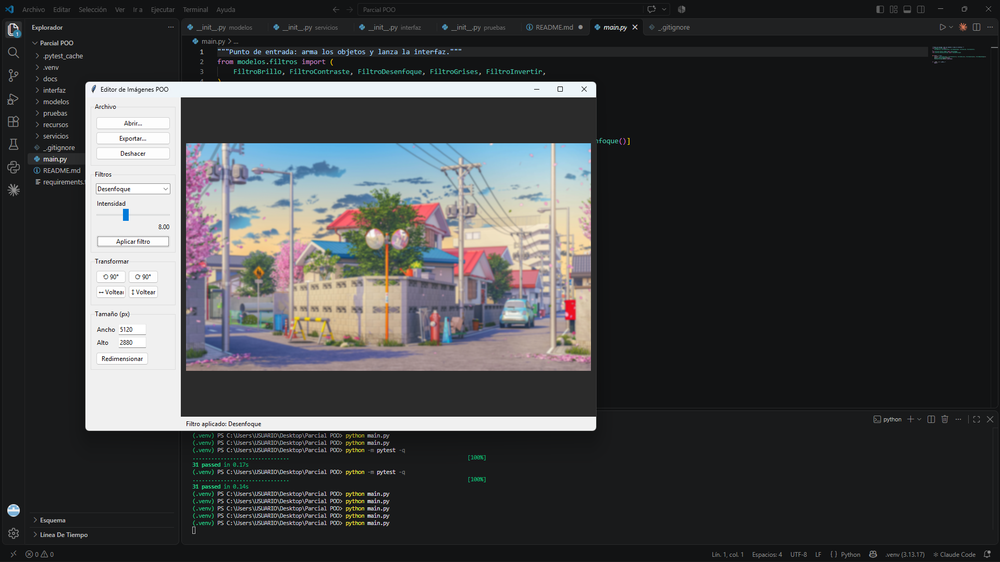
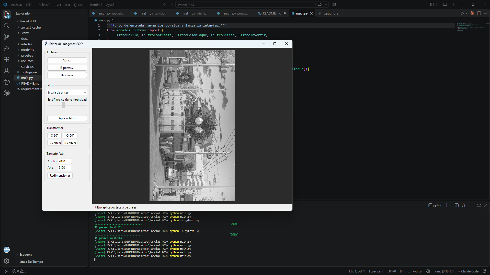

# Editor de Imágenes POO: Retoque Rápido de Fotografías

Aplicación de escritorio desarrollada en Python bajo el paradigma de Programación Orientada a Objetos (POO), con interfaz gráfica en Tkinter y procesamiento de imágenes con Pillow. Permite abrir una imagen, aplicarle filtros intercambiables, transformarla, deshacer los cambios y exportar el resultado, con una vista previa que se actualiza al instante.

## Tabla de Contenidos

1. [Descripción del Problema](#1-descripción-del-problema)
2. [Objetivos del Proyecto](#2-objetivos-del-proyecto)
3. [Funcionalidades Principales](#3-funcionalidades-principales)
4. [Arquitectura y Diagrama del Sistema](#4-arquitectura-y-diagrama-del-sistema)
5. [Estructura del Repositorio](#5-estructura-del-repositorio)
6. [Tecnologías Utilizadas](#6-tecnologías-utilizadas)
7. [Instalación y Configuración](#7-instalación-y-configuración)
8. [Ejecución y Pruebas](#8-ejecución-y-pruebas)
9. [Manual de Usuario](#9-manual-de-usuario)
10. [Documentación Técnica](#10-documentación-técnica)
11. [Evidencias y Capturas de Pantalla](#11-evidencias-y-capturas-de-pantalla)

## 1. Descripción del Problema

Editar una foto de forma rápida (pasarla a grises, corregir el brillo o el contraste, girarla o cambiarle el tamaño) suele requerir programas pesados o sitios web que obligan a subir los archivos a internet. Además, el trabajo sin validaciones produce errores comunes: medidas inválidas, archivos que no son imágenes o cambios que no se pueden revertir.

Editor de Imágenes POO resuelve esta necesidad con un entorno de escritorio ligero y local, que valida cada dato ingresado, avisa con mensajes claros cuando algo sale mal y permite deshacer los cambios.

## 2. Objetivos del Proyecto

El objetivo general es desarrollar una aplicación funcional en Python que integre los principios de POO y una interfaz gráfica interactiva.

Como objetivos específicos, el proyecto busca:

- Aplicar encapsulamiento, herencia, polimorfismo y abstracción.
- Separar los modelos y la lógica de negocio de la capa de presentación.
- Ofrecer retroalimentación visual inmediata mediante una vista previa de la imagen.
- Verificar el funcionamiento con pruebas automatizadas.

## 3. Funcionalidades Principales

- **Archivo:** abrir imágenes (PNG, JPG, BMP, GIF, WEBP) y exportar el resultado en PNG, JPG o BMP.
- **Filtros:** escala de grises, invertir colores, brillo, contraste y desenfoque, estos tres últimos con control de intensidad.
- **Transformaciones:** rotar 90° a izquierda o derecha, voltear horizontal o verticalmente y redimensionar en píxeles.
- **Historial:** deshacer hasta 20 cambios (también con Ctrl+Z).
- **Manejo de errores:** archivos inválidos, medidas que no son números, valores fuera de rango y extensiones de exportación desconocidas generan un aviso en lugar de cerrar el programa.

## 4. Arquitectura y Diagrama del Sistema

El sistema utiliza una arquitectura por capas con dependencias en un solo sentido: la interfaz usa a los servicios, los servicios usan a los modelos y los modelos no dependen de nadie. Esto permite probar toda la lógica sin abrir ninguna ventana.



Para leer el análisis completo de la arquitectura, dirígete al [Informe Técnico](docs/INFORME_TECNICO.md).

## 5. Estructura del Repositorio

```
editor_imagenes/
│
├── main.py                         # Punto de entrada: crea los objetos y abre la ventana
├── requirements.txt                # Dependencias (Pillow, pytest)
├── README.md                       # Este documento
│
├── modelos/                        # Entidades y reglas
│   ├── errores.py                  # Excepciones propias
│   ├── documento_imagen.py         # Imagen abierta e historial para deshacer
│   └── filtros.py                  # Clase abstracta Filtro y filtros concretos
│
├── servicios/                      # Lógica de la aplicación
│   └── editor_imagen.py            # Coordina documento y filtros
│
├── interfaz/                       # Componentes visuales
│   └── ventana_principal.py        # Ventana Tkinter
│
├── recursos/                       # Imagen de prueba
│   └── ejemplo.png
│
├── pruebas/                        # Pruebas automatizadas
│   ├── test_filtros.py
│   └── test_editor.py
│
└── docs/                           # Documentación anexa
    ├── INFORME_TECNICO.md          # Informe técnico detallado
    └── imagenes/                   # Capturas de pantalla
```

## 6. Tecnologías Utilizadas

- Python 3.10 o superior
- Tkinter (interfaz gráfica, incluida con Python)
- Pillow (procesamiento de imágenes)
- pytest (pruebas unitarias)

## 7. Instalación y Configuración

1. Clona el repositorio y entra a la carpeta:
   ```
   git clone https://github.com/TU-USUARIO/editor-imagenes.git
   cd editor-imagenes
   ```
2. Crea y activa tu entorno virtual:
   ```
   python -m venv .venv
   # Windows: .venv\Scripts\activate
   # Mac/Linux: source .venv/bin/activate
   ```
3. Instala las dependencias:
   ```
   pip install -r requirements.txt
   ```

En Linux, Tkinter puede requerir instalarse aparte con `sudo apt install python3-tk`.

## 8. Ejecución y Pruebas

Para abrir la aplicación:

```
python main.py
```

Para ejecutar las pruebas y validar el núcleo POO:

```
python -m pytest -v
```

## 9. Manual de Usuario

1. **Abrir una imagen:** pulsa Abrir (o Ctrl+O) y elige un archivo. Puedes probar con `recursos/ejemplo.png`. Al abrirla, los campos de tamaño muestran sus dimensiones.
2. **Aplicar un filtro:** elígelo en la lista desplegable. Si tiene intensidad, ajusta el deslizador y pulsa Aplicar filtro.
3. **Transformar:** usa los botones de rotación y volteo. Para cambiar el tamaño, escribe el ancho y el alto en píxeles y pulsa Redimensionar.
4. **Deshacer:** si te equivocas, pulsa Deshacer (o Ctrl+Z) para volver al estado anterior.
5. **Exportar:** pulsa Exportar (o Ctrl+S), elige el nombre y el formato, y guarda el resultado.

## 10. Documentación Técnica

Para entender en profundidad cómo se diseñaron las clases, dónde se aplicó cada concepto de POO y revisar los resultados de las pruebas, lee el informe:

👉 [Informe Técnico Completo](docs/INFORME_TECNICO.md)

## 11. Evidencias y Capturas de Pantalla

Ventana al iniciar, sin imagen cargada:



Imagen abierta con su vista previa:



Filtro de desenfoque aplicado:



Imagen en escala de grises y rotada:



**Autor:** Yeimer Ortiz Reales. **Asignatura:** Programación orientada a objetos, Ingeniería de Sistemas.
