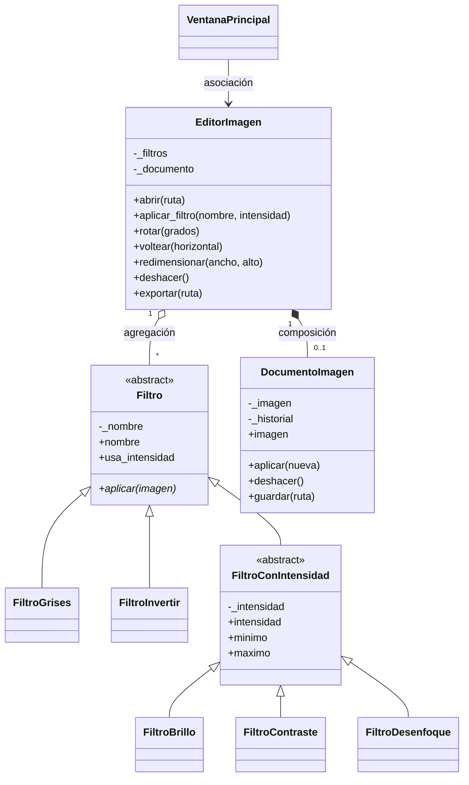
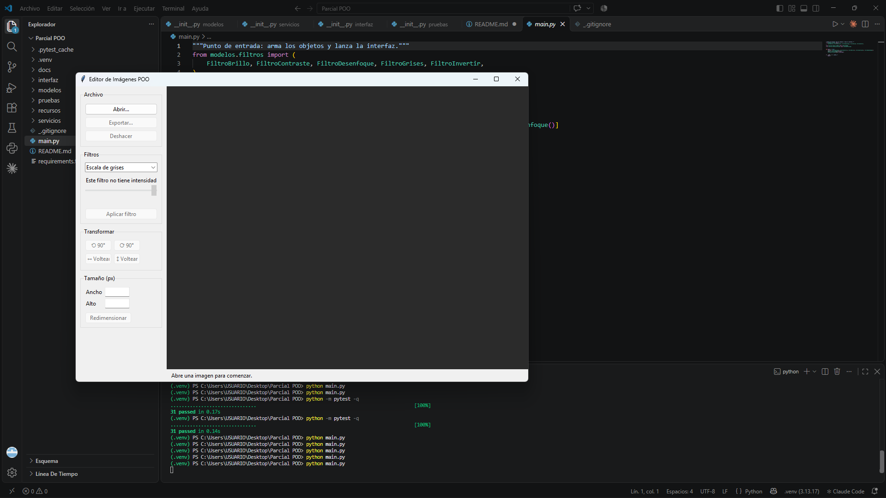
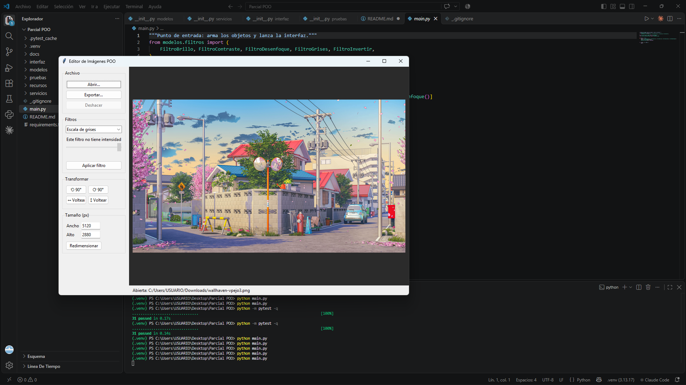
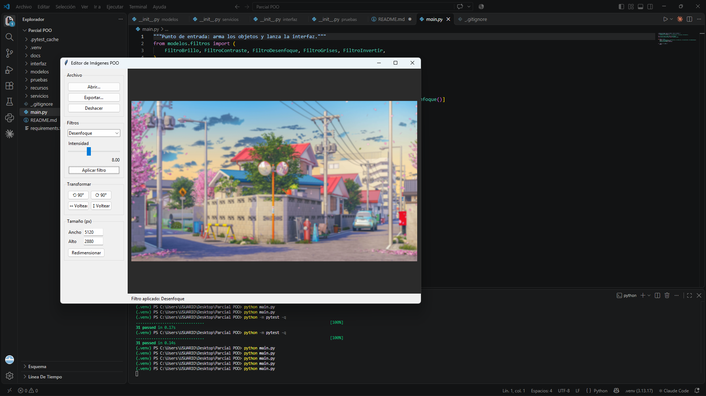
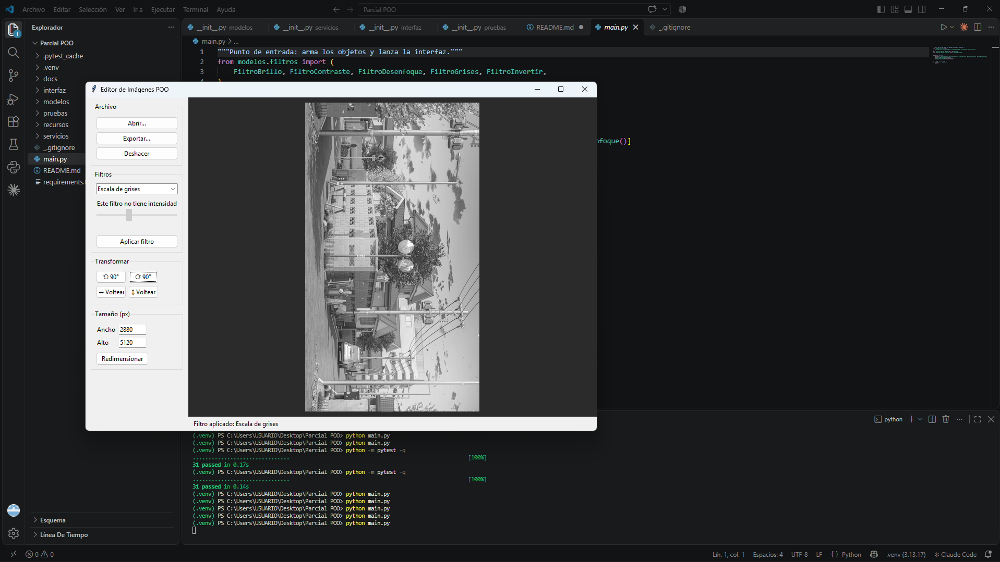

# Informe técnico: Editor de Imágenes POO

Autor: Yeimer Ortiz Reales. Asignatura: Programación II, Ingeniería de Sistemas.

## 1. Análisis del problema

Mucha gente necesita retoques básicos sobre una imagen (convertirla a grises, corregir brillo o contraste, girarla o reducir su tamaño) y recurre a programas pesados o a sitios web que obligan a subir sus archivos. La necesidad identificada es una herramienta local, ligera y fácil de usar. El público objetivo son estudiantes y personas sin experiencia en edición que quieren hacer ajustes rápidos.

La aplicación ofrece cinco filtros, cuatro transformaciones geométricas, redimensionado, historial para deshacer y exportación. Como limitaciones, trabaja con una sola imagen a la vez, no guarda proyectos ni sesiones (el enunciado no exige persistencia), el historial se limita a 20 pasos y la vista previa es una reducción de la imagen real, no un editor con zoom.

## 2. Diseño inicial

Antes de programar se identificaron los sustantivos del problema, que dieron origen a las clases, y los verbos, que dieron origen a los métodos. La imagen que se edita pasó a ser `DocumentoImagen`; la idea de "efecto aplicable" pasó a ser `Filtro`, con una variante por cada efecto; quien coordina las operaciones es `EditorImagen`; y lo que el usuario ve es `VentanaPrincipal`.

Las responsabilidades quedaron así. `DocumentoImagen` guarda la imagen actual y su historial. `Filtro` define el contrato de transformar una imagen, y cada filtro concreto lo implementa a su manera. `EditorImagen` valida las peticiones y las ejecuta sobre el documento. `VentanaPrincipal` captura eventos, llama al editor y muestra resultados o errores. Las excepciones propias (`ErrorEditor` y sus derivadas) permiten que la ventana muestre mensajes comprensibles sin conocer a Pillow.

## 3. Arquitectura

El código se divide en tres capas con dependencias en un solo sentido: la interfaz depende de los servicios, los servicios dependen de los modelos y los modelos no dependen de nadie.

La carpeta `modelos` contiene las clases de datos y reglas (documento, filtros, errores). La carpeta `servicios` contiene `EditorImagen`, que es la lógica de la aplicación. La carpeta `interfaz` contiene la ventana de Tkinter. El archivo `main.py` solo ensambla los objetos: crea los filtros, se los entrega al editor y entrega el editor a la ventana. Esta separación hace posible probar toda la lógica con pytest sin abrir ninguna ventana, y es la razón por la que la interfaz no concentra la lógica del sistema.

La comunicación es siempre una llamada de arriba hacia abajo. Cuando el usuario pulsa un botón, la ventana llama a un método del editor; si el editor lanza una excepción `ErrorEditor`, la ventana la captura en un único lugar (`_ejecutar`) y muestra el aviso; si todo sale bien, la ventana vuelve a pedir la imagen y la dibuja.

## 4. Diagrama de clases



## 5. Aplicación de POO

| Concepto | Clase o método | Archivo | Explicación |
|---|---|---|---|
| Clases y objetos | `DocumentoImagen`, `EditorImagen`, `VentanaPrincipal`, cada `Filtro` | `modelos/`, `servicios/`, `interfaz/` | Cada clase tiene una responsabilidad; `main.py` crea los objetos y los conecta. |
| Encapsulamiento | `DocumentoImagen._imagen` y propiedad `imagen` | `modelos/documento_imagen.py` | La propiedad devuelve una copia, de modo que nadie altera la imagen ni el historial sin pasar por `aplicar` o `deshacer`. |
| Encapsulamiento | `FiltroConIntensidad.intensidad` (setter) | `modelos/filtros.py` | El setter valida tipo y rango; un valor inválido lanza `ParametroInvalidoError` y no cambia el estado. |
| Herencia | `FiltroBrillo`, `FiltroContraste`, `FiltroDesenfoque` | `modelos/filtros.py` | Heredan de `FiltroConIntensidad` la validación y los límites, y llaman a `super().__init__` con su rango propio. |
| Polimorfismo | `Filtro.aplicar()` | `modelos/filtros.py` | Los cinco filtros responden al mismo método con efectos distintos; `EditorImagen.aplicar_filtro` los usa sin saber cuál es. |
| Abstracción | `Filtro` y `FiltroConIntensidad` (ABC) | `modelos/filtros.py` | `aplicar` es un método abstracto: fija el contrato y no permite instanciar un filtro incompleto. |
| Relaciones | `EditorImagen` con `DocumentoImagen` | `servicios/editor_imagen.py` | Composición: el editor crea el documento al abrir y es su dueño. |
| Relaciones | `EditorImagen` con `Filtro` | `servicios/editor_imagen.py` | Agregación: recibe el catálogo ya creado; los filtros existen sin el editor. |
| Relaciones | `VentanaPrincipal` con `EditorImagen` | `interfaz/ventana_principal.py` | Asociación: la ventana usa al editor que le entregan, sin crearlo. |

La herencia se aplicó solo donde se justifica. `FiltroGrises` y `FiltroInvertir` no tienen parámetros y heredan directamente de `Filtro`. Los otros tres comparten una necesidad real (un valor numérico acotado y validado), por lo que esa lógica se escribió una sola vez en `FiltroConIntensidad`. Un fragmento de esa clase:

```python
@intensidad.setter
def intensidad(self, valor: float) -> None:
    try:
        valor = float(valor)
    except (TypeError, ValueError) as error:
        raise ParametroInvalidoError("La intensidad debe ser un número.") from error
    if not self._minimo <= valor <= self._maximo:
        raise ParametroInvalidoError(...)
    self._intensidad = valor
```

El polimorfismo se ve en `EditorImagen.aplicar_filtro`, que obtiene un `Filtro` por su nombre y llama a `filtro.aplicar(...)` sin condicionales por tipo. Agregar un filtro nuevo solo requiere crear una clase y añadirla a la lista en `main.py`.

## 6. Construcción de la interfaz

Se eligió Tkinter con el módulo `ttk` porque viene incluido con Python, no añade dependencias y es suficiente para los controles necesarios. La ventana tiene un panel izquierdo con cuatro grupos (Archivo, Filtros, Transformar y Tamaño) y, a la derecha, un lienzo (`Canvas`) donde se dibuja la vista previa y una barra de estado con el último mensaje.

Los controles son botones, una lista desplegable de solo lectura con los filtros, un deslizador de intensidad y dos campos de texto para ancho y alto. La interfaz es dirigida por eventos: cada botón tiene un callback (`command=`), la lista desplegable reacciona al evento `<<ComboboxSelected>>` para reconfigurar el deslizador según el filtro elegido, el lienzo reacciona a `<Configure>` para redibujar la imagen cuando se cambia el tamaño de la ventana, y los atajos Ctrl+O, Ctrl+S y Ctrl+Z están vinculados con `bind`.

La ventana no contiene lógica de edición. Cada callback delega en un método de `EditorImagen` a través de `_ejecutar`, que atrapa los `ErrorEditor` y los muestra con `messagebox`. Los botones que no tienen sentido sin imagen (Exportar, Aplicar, Redimensionar, Transformar) se deshabilitan hasta que se abre una, y Deshacer se habilita solo si hay historial.

Capturas de la aplicación en funcionamiento:









## 7. Proceso de desarrollo

Primero se formuló la idea: un editor pequeño de imágenes, porque permite demostrar polimorfismo y abstracción de manera natural con los filtros y porque el enunciado valora más una aplicación acotada y completa que una ambiciosa e incompleta. Luego se identificaron las funcionalidades mínimas (filtros, transformaciones y exportación) y se diseñaron las clases con sus responsabilidades.

La lógica se construyó antes que la interfaz, empezando por los modelos (`Filtro` y sus derivadas, `DocumentoImagen`), después el servicio `EditorImagen` y, en paralelo, las pruebas con pytest. Con la lógica verificada se desarrolló la ventana de Tkinter y se integró todo desde `main.py`. En la etapa final se probó la interfaz de forma manual y con un guion automatizado, se tomaron las capturas y se corrigieron detalles como un parámetro sobrante en la ventana. Se recomienda subir al repositorio un commit por cada una de estas etapas para que el historial lo refleje.

## 8. Pruebas

El proyecto incluye 31 pruebas automatizadas en la carpeta `pruebas` (comando `python -m pytest -q`), todas aprobadas. Además se documentan a continuación pruebas funcionales sobre la interfaz.

| Prueba | Acción realizada | Resultado esperado | Resultado obtenido |
|---|---|---|---|
| Prueba 1 | Abrir `recursos/ejemplo.png` desde el botón Abrir | La imagen se muestra y los campos de tamaño indican 640 y 400 | Correcto: vista previa visible y tamaño 640 x 400 |
| Prueba 2 | Elegir Desenfoque, intensidad 4.0, Aplicar filtro y luego Deshacer | La imagen se desenfoca y, al deshacer, vuelve a su estado original | Correcto: el desenfoque se aplicó y el historial quedó vacío tras deshacer |
| Prueba 3 | Aplicar Escala de grises y rotar 90° a la derecha | Imagen en grises con dimensiones intercambiadas (400 x 640) | Correcto: tamaño 400 x 640 y colores en gris |
| Prueba 4 (entrada inválida) | Escribir "abc" en Ancho y pulsar Redimensionar | Aviso de error y la imagen no cambia | Correcto: aviso "Ancho y alto deben ser números enteros." y tamaño sin cambios |
| Prueba 5 | Redimensionar a 300 x 480 y exportar como PNG | Se crea el archivo con ese tamaño | Correcto: archivo generado y tamaño 300 x 480 |

## 9. Problemas y soluciones

El primer problema fue la vista previa. En Tkinter, una imagen mostrada en un `Canvas` desaparece si el objeto `PhotoImage` no tiene ninguna referencia viva, porque el recolector de basura lo elimina. El diagnóstico fue reconocer que se creaba como variable local dentro del método de dibujo. La solución fue guardarla como atributo de la ventana (`self._foto`) en cada redibujado.

El segundo fue el riesgo de modificar la imagen sin querer. Si `DocumentoImagen` devolviera su objeto interno, cualquier código externo podría alterarlo y corromper el historial de deshacer. La solución fue encapsular: la propiedad `imagen` devuelve una copia, y existe una prueba (`test_imagen_actual_es_copia`) que verifica que cambiar la copia no afecta al documento.

El tercero fue que cada filtro con intensidad necesita un rango distinto (el desenfoque va de 0 a 20 y el brillo de 0.2 a 3). En lugar de repetir la validación en cada clase, se creó `FiltroConIntensidad`, y la ventana lee `minimo`, `maximo` e `intensidad` del filtro elegido para reconfigurar el deslizador, de modo que la interfaz no tiene valores fijos por filtro.

## 10. Conclusiones

El proyecto permitió aplicar en un caso concreto los conceptos del semestre: clases con responsabilidades claras, encapsulamiento con una función real (validar y proteger el estado), herencia justificada, polimorfismo y abstracción mediante un contrato común para los filtros, y relaciones de composición, agregación y asociación. La separación en capas facilitó las pruebas y mantuvo la interfaz simple.

La principal dificultad fue decidir dónde poner cada responsabilidad para que la ventana no acumulara lógica. Como mejoras posibles se identifican añadir más filtros (nitidez, sepia), permitir recortar una zona de la imagen, ofrecer vista previa antes de aplicar un filtro, rehacer cambios (lo contrario de deshacer) y migrar la interfaz a CustomTkinter para un aspecto más moderno.
